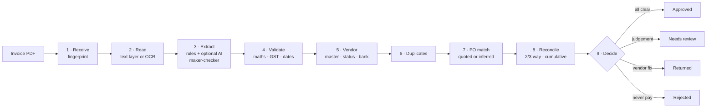

# AP Invoice Agent: invoice PDF → reasoned AP decision

A working accounts-payable process for **PS-1 (Invoice processing: from PDF to decision)**. Drop in a vendor invoice, digital or scanned. The process reads it, extracts the data, and checks it against the vendor master, purchase orders, goods receipts and earlier invoices. It then makes a decision it can explain:

| Outcome | Meaning | What the process produces |
|---|---|---|
| ✅ **Approved** | Everything verified within policy | Ledger posting + payment instruction (always to the *verified master* bank account) |
| 🟠 **Needs review** | A person must make a judgement call | Routed task: *who* should look, *the exact question*, the evidence, and any precedent |
| 🟣 **Returned** | The vendor must fix and re-issue the invoice | Drafted correction email to the vendor's master contact |
| 🔴 **Rejected** | Must never be paid (duplicate, blocked vendor) | Processing stops and a courtesy note is drafted |

Every stage runs live in the UI. A dashboard tracks history, outcomes, exception reasons, and human decisions across runs.

> **Live demo:** _add your Render URL here_ · **Demo video:** _add your Loom link here_

---

## The process (9 stages)



| # | Stage | What it does | Why it matters |
|---|---|---|---|
| 1 | Receive | Validates the PDF, SHA-256 fingerprint | The exact same file can never be paid twice |
| 2 | Read | Digital text layer read exactly; scans are rendered at 300 DPI, **deskewed**, OCR'd with Tesseract, with a confidence score | Real invoices arrive both ways |
| 3 | Extract | Rule-based reader (label-anchored fields, column-aware tables, totals, GST, bank details, amount-in-words). An optional **Gemini AI reader** reads independently and the two are reconciled field by field | Every field shows *how* it was found, the text it came from, and a confidence |
| 4 | Validate | Is it a tax invoice (not a proforma/quotation) in INR? Then qty × rate, Σ lines = subtotal, subtotal + GST = total, **total in figures = total in words**, GST computed on the right base, CGST+SGST vs IGST by supplier state, valid supplier GSTIN, our GSTIN on the invoice, dates | Catches vendor errors before they hit the books, and protects GST input credit |
| 5 | Vendor | Vendor master by GSTIN (then fuzzy name), blocked vendors, GSTIN match, **bank details vs master**, contact details vs master | Payment-fraud control |
| 6 | Duplicates | Same file; same **normalised** invoice number (`TS/26-27/0418` = `TS-2627-418`); same amount + date within ±7 days | Duplicate payments are the most common AP leak |
| 7 | PO match | Quoted PO is validated (exists, open, right vendor). With **no PO**, it is inferred from vendor + items + prices + remaining value, with a score and a margin over the runner-up | PO references are often implied or missing |
| 8 | Reconcile | Price vs PO (±2%), **cumulative** quantity and value across all earlier invoices on the PO, quantity received on GRNs (3-way match for goods; 2-way for services), header-level match for bundled service invoices | Split invoices and partial deliveries hide over-billing |
| 9 | Decide | Deterministic policy: **reject > payment-security hold > return > review > approve**, plus the auto-approval limit gate | Same invoice → same answer; every decision is auditable |

A human reviewer can **approve / return / reject** anything in *Needs review*. That decision, who made it and their note are recorded on the audit trail and update the ledger. Past reviewer decisions are surfaced as **precedent** on similar exceptions.

## Edge cases built in

Prepared inputs are in [`samples/demo`](samples/demo), and you can run any of them from the UI with one click.

| Scenario | Why it's hard | What the process does | Outcome |
|---|---|---|---|
| **Happy path:** Techsupply laptops, digital PDF, PO quoted | Nothing; it should flow straight through | All checks pass; posted against PO 4500001201; payment scheduled to the master account | ✅ Approved |
| **Edge 1: Scanned paper invoice, no PO number** | No text layer; OCR misreads the GSTIN (inserts a character); the vendor has *two* open POs | OCR + deskew; GSTIN repaired using the checksum + vendor master; PO inferred (score 1.00 vs 0.07); notes the inference | ✅ Approved, PO inferred |
| **Edge 2: Split PO, third invoice over-bills** | The invoice is perfect *on its own*; the problem is the two invoices already approved on the same PO | Tracks cumulative quantity and value per PO line and goods received: 115% of the PO, more than received | 🟠 Needs buyer review |
| **Edge 3: Duplicate in disguise** | A "payment reminder" re-send: new file, new layout, number reformatted `TS/26-27/0418` → `TS-2627-418` | Normalised-number match against history; stops before PO matching | 🔴 Rejected + courtesy note |
| **Edge 4: Perfect invoice, new bank account** | Every number is right; only the payment destination changed, from a non-master email | Bank details ≠ verified master → payment hold; asks for a call-back on the *master* phone number | 🟠 Payment on hold (high priority) |
| Price above PO (+8%) | Commercial judgement | Buyer review, citing the precedent (a +6% surcharge the buyer approved last week) | 🟠 Needs review |
| Invoice number missing | Can't book it or claim GST credit | Correction email drafted | 🟣 Returned |
| Blocked vendor (GST cancelled) | Master-data control | Stopped | 🔴 Rejected |

The database starts with **7 historical invoices** processed through the same pipeline, so the dashboard has context and the stateful cases (split billing, duplicates, precedent) work immediately. **Reset demo data** in the sidebar restores that state.

## Design choices

- **AI reads, rules decide.** Reading messy documents is a perception problem, so OCR and an LLM help there. Deciding whether to pay is a policy problem, so it stays deterministic: reproducible, explainable and auditable. No LLM is in the decision path.
- **Maker-checker extraction.** With a Gemini key, two independent readers extract every field. Agreement raises confidence. A disagreement is settled by hard evidence on the page: the GSTIN checksum, line maths, and the total written in words. On a digital PDF the exact text wins. If evidence can't settle a money or identity field on a scan, a person checks that field rather than the system guessing.
- **Judge the invoice in context, not in isolation.** The costliest mistakes look fine on their own. So the process checks history (ledger, earlier runs) and master data, not just the PDF.
- **Escalate with a question, not a shrug.** *Needs review* always names the queue and assignee, asks a specific question, shows evidence and precedent, and blocks payment until resolved.
- **Never trust contact or bank details printed on an invoice.** Payments go to the verified master account, and emails go to the master contact.
- **Fail fast on hard rejections.** A duplicate or a blocked vendor stops the run before PO matching, so nothing downstream can post it.

## Where AI is used

| Component | Technique |
|---|---|
| Scanned documents | Tesseract 5 LSTM OCR + projection-profile deskew |
| Field extraction | Deterministic layout parser (always on) + **Google Gemini** as an independent second reader (optional, `GEMINI_API_KEY`) via the Interactions API with a JSON-schema response, with fallback to `generateContent` |
| OCR error repair | GSTIN checksum + vendor-master nearest match |
| PO inference | Fuzzy line-item matching (RapidFuzz) + price and amount scoring |
| Decisions | **None.** Deterministic policy ([`data/reference/policy.json`](data/reference/policy.json)) |

The process runs fully without an API key. If the AI call fails (quota, network), the run logs it and continues on the rule-based reader.

## Assumptions

- The buyer is a fictional Indian mid-size retailer, **Nimbus Retail Pvt. Ltd.** (Bengaluru, GST state 29). Invoices are GST tax invoices in INR, and dates are day-first.
- The vendor master, POs, goods receipts and policy are JSON stand-ins for an ERP ([`data/reference`](data/reference)). Approved invoices consume PO balances in a ledger (SQLite).
- All invoices and data are synthetic, generated by [`scripts/generate_data.py`](scripts/generate_data.py) with 7 different vendor layouts and one simulated paper scan.
- Policy thresholds are data, not code: ±2% price tolerance, ₹5,000 total-excess cap, 2% PO over-billing tolerance, ₹10 lakh auto-approval limit, PO-inference score ≥ 0.80 with margin ≥ 0.15.
- Stages are deliberately paced (`STAGE_DELAY_MS`, default 650 ms) so a person can watch them live. The UI reports the real machine time separately (≈0.1–0.3 s per digital invoice, ≈4 s per scan).

## Limitations / what I'd build next

- **Inputs:** an email/SFTP inbox connector instead of upload; multi-invoice PDFs; non-INR invoices (currently routed to review rather than guessed).
- **GST depth:** the GST type is derived from supplier state vs buyer state, and each invoice is assumed to have one GST slab. Next would be per-slab taxable values and printed place-of-supply handling.
- **Learning loop:** today, reviewer decisions are surfaced as precedent. Next, they would suggest policy changes (e.g. "freight surcharges ≤ 6% approved 9/10 times").
- **ERP integration:** read POs/GRNs and post invoices through the ERP API; real vendor-change workflow with call-back logging.
- **Persistence:** SQLite on the host's ephemeral disk is fine for a demo (the history is re-seeded on start). Production would use Postgres and object storage.
- **Security:** this is an open demo. Production needs SSO with reviewer roles (today the reviewer is a free-text name), redaction of bank details in API responses, and a signed audit log. Only the reset action is protected (`ADMIN_TOKEN`).

## Run locally

```bash
# Python 3.12 + Tesseract (apt install tesseract-ocr  |  brew install tesseract  |  conda install -c conda-forge tesseract)
pip install -r requirements-dev.txt
cp .env.example .env          # optional: add GEMINI_API_KEY
uvicorn app.main:app --reload --port 8000
# open http://localhost:8000
pytest -q                      # 58 tests: extraction on every sample, every scenario's decision, API, AI merge (mocked), robustness
```

Regenerate the reference data and sample invoices with `python scripts/generate_data.py`.

## Deploy (Render, free tier)

1. Push this repo to GitHub.
2. Render Dashboard → **New → Blueprint** → select the repo. [`render.yaml`](render.yaml) creates one free Docker web service; the [`Dockerfile`](Dockerfile) installs Tesseract.
3. When prompted, paste `GEMINI_API_KEY` (optional), then deploy. The health check is `/api/health`.

The free tier sleeps after 15 minutes idle (the first request then takes about a minute) and its disk is ephemeral. Demo history is re-created automatically on start. **Reset demo data** asks for the `ADMIN_TOKEN`, which Render generates; you'll find it under the service's *Environment* tab.

## Project layout

```
app/
  main.py               FastAPI: API + static UI
  pipeline/
    reader.py           text layer / OCR (deskew) -> positioned lines
    parser.py           rule-based field extraction with evidence + confidence
    ai_reader.py        Gemini reader (Interactions API, JSON schema)
    merge.py            maker-checker reconciliation of the two readers
    checks.py           validation, vendor, duplicates, PO match/inference, 2/3-way reconciliation
    decision.py         policy precedence, outputs (payment / review task / vendor email)
    runner.py           9-stage orchestration, live events, ledger posting, human review, seeding
  utils/                GSTIN checksum + OCR repair, Indian money/words, normalisation
static/                 UI (vanilla JS/CSS, no build step)
data/reference/         company, vendors, POs, GRNs, policy
samples/                demo + history invoices, manifest
scripts/generate_data.py
tests/
```
